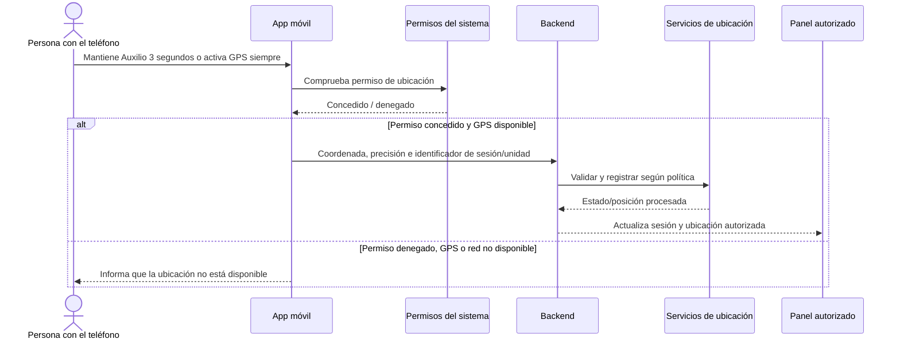
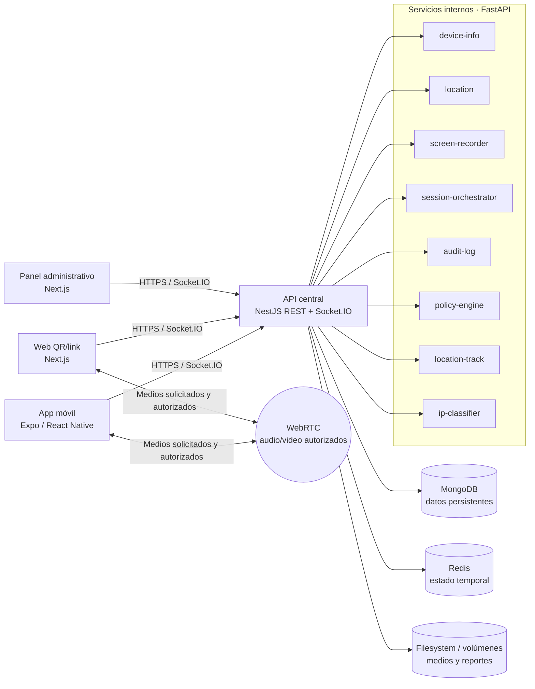

# Kids4Safe

<p align="center">
  
</p>


[](LICENSE) [](https://nodejs.org/) [](https://www.typescriptlang.org/) [](https://www.python.org/) [](https://nestjs.com/) [](https://fastapi.tiangolo.com/) [](https://expo.dev/)

**Kids4Safe** es una plataforma de asistencia y protección familiar. Esta edición demostrativa integra una app móvil, una experiencia web QR/link, un panel administrativo, una API central y ocho microservicios. Sirve para que una familia configure perfiles y dispositivos, active una solicitud de Auxilio, comparta la ubicación del teléfono con personas autorizadas y consulte el estado de una sesión.

> **Edición de demostración:** use cuentas y datos ficticios. La disponibilidad de cada función depende de la configuración de los servicios, conexión a internet, compatibilidad del dispositivo y permisos concedidos por la persona usuaria.

## Qué permite hacer

### Aplicación móvil

- Crear y administrar un perfil con información útil para una emergencia.
- Consultar el estado del dispositivo, los permisos configurados y la actividad reciente.
- Activar Auxilio manteniendo pulsado el botón durante **tres segundos**. La app solicita al backend crear una sesión y comunica su estado al panel y destinatarios configurados.
- Compartir la ubicación GPS del teléfono mientras el permiso correspondiente esté concedido y el dispositivo pueda obtener una posición. La precisión depende del GPS, los ajustes del sistema, la recepción y la conectividad.
- Habilitar la opción **GPS siempre** desde Seguridad. En ese modo, la app puede enviar actualizaciones de ubicación mientras está en uso, siempre que tenga permiso de ubicación.
- Durante una sesión de Auxilio activa, intentar continuar el envío de ubicación en segundo plano si la persona concedió el permiso de fondo. Android/iOS presentan sus indicadores y avisos de sistema; el seguimiento puede interrumpirse por batería, cobertura, ajustes del dispositivo o restricciones del sistema operativo.
- Recibir notificaciones y solicitudes que requieren permisos visibles del dispositivo. La persona puede denegar permisos o revocarlos desde los ajustes del teléfono.

La app no sustituye los servicios públicos de emergencia ni garantiza que una alerta llegue a tiempo. Ante peligro inmediato, contacte directamente con el número de emergencia local.

### Panel administrativo

El personal con cuenta y permisos puede consultar sesiones, alertas, perfiles vinculados, dispositivos, ubicaciones, historial, notificaciones y medios disponibles. Las acciones dependen del rol del usuario y de las autorizaciones de la sesión. La interfaz puede ocultar inicialmente coordenadas o contactos; esa presentación visual no sustituye los controles de acceso del backend.

### Experiencia QR/link

El frontend web abre flujos QR/link y publica una sesión cuando se ha configurado la política, la persona acepta la solicitud y el navegador concede los permisos necesarios. El flujo QR/link es independiente de la activación directa de Auxilio desde la app móvil.

## Cómo funciona el seguimiento de ubicación

1. La persona habilita la función en Seguridad y concede el permiso de ubicación en el sistema operativo.
2. La app obtiene una coordenada del teléfono y, si tiene conexión, la envía al backend con la identidad de la unidad/sesión.
3. El backend valida la solicitud y coordina los servicios de ubicación e historial habilitados.
4. El panel presenta la última posición y, cuando existe historial, la ruta asociada a la sesión con acceso autorizado.
5. Al desactivar la preferencia o terminar la sesión, cesan las actualizaciones asociadas a ese modo; los datos ya recibidos pueden conservarse de acuerdo con la configuración de retención del backend.

En segundo plano, la app usa la tarea nativa de ubicación y declara que comparte ubicación durante Auxilio activo. El permiso “siempre” no elimina los indicadores de Android/iOS ni debe ocultarse a quien lleva el dispositivo. El estado en el panel puede estar retrasado si el teléfono pierde conexión.



## Límites legales y de privacidad

Kids4Safe está pensado para asistencia y uso familiar transparente. El control parental debe respetar la legislación aplicable en el lugar donde se usa y los derechos de la persona menor, incluida su privacidad y autonomía progresiva. La autoridad parental o la propiedad del dispositivo no deben interpretarse como autorización ilimitada para vigilar.

Antes de usarlo fuera de una demostración:

- Explique qué datos se recopilan, cuándo, para qué destinatarios y durante cuánto tiempo.
- Obtenga consentimiento, autorización parental u otra base legal cuando corresponda, teniendo en cuenta la edad y las reglas de cada jurisdicción.
- Mantenga visibles las funciones de ubicación, cámara, micrófono y pantalla; no active seguimiento secreto ni eluda indicadores o controles del sistema.
- Active únicamente las funciones necesarias, limite quién puede consultar la información y establezca un plazo de retención y borrado.
- Use datos ficticios en esta demo y evite incorporar información de menores a capturas, logs o informes de soporte.

Este README y la licencia MIT no son asesoría jurídica ni certificación de cumplimiento. No use Kids4Safe para vigilancia encubierta, acoso, control coercitivo, seguimiento no autorizado o acceso a información privada de terceros.

## Arquitectura y comunicación



MongoDB conserva datos persistentes y Redis coordina estado temporal. El backend expone la API REST y Socket.IO; los microservicios separan tareas de dispositivo, ubicación, políticas, auditoría y ciclo de sesión. WebRTC puede transportar medios entre clientes cuando una sesión y los permisos lo permiten. El clasificador de IP puede consultar servicios de geolocalización aproximada según la configuración.

## Componentes y puertos locales

| Directorio | Función | Puerto |
| --- | --- | ---: |
| `app-movil/` | App Expo; web local y builds nativos | 8081 |
| `frontend/` | Web pública y flujo QR/link | 3000 |
| `admin-panel/` | Panel de administración | 3002 |
| `backend/` | API, autenticación, sesiones, datos y medios | 7000 |
| `microservicio-device-info/` | Contexto de dispositivo y capacidades | 5001 |
| `microservicio-location/` | Coordenadas, precisión y geocercas | 5002 |
| `microservicio-screen-recorder/` | Capturas JPEG | 5003 |
| `microservicio-session-orchestrator/` | Heartbeats y ciclo de vida de sesiones | 5005 |
| `microservicio-audit-log/` | Eventos de auditoría | 5006 |
| `microservicio-policy-engine/` | Evaluación de políticas | 5007 |
| `microservicio-location-track/` | Historial de ubicaciones | 5008 |
| `microservicio-ip-classifier/` | Clasificación de IP/dispositivo | 5009 |

## Requisitos

- Node.js compatible con los `engines` de cada `package.json` (la guía de los componentes recomienda Node 24.19.0).
- Corepack, pnpm 10.12.1 para móvil y aplicaciones web; Yarn 4 para backend.
- Python 3.11 y entorno virtual por microservicio.
- MongoDB y Redis accesibles para el backend y los servicios que los utilizan.
- Para builds nativos: cuenta/configuración de EAS y archivos cliente Firebase de Android/iOS.

## Preparar el entorno

Abra una terminal en la raíz del proyecto. Copie la plantilla de cada componente como `.env.local` y defina valores locales. No use credenciales reales de producción en esta demostración. Las variables `EXPO_PUBLIC_*` y `NEXT_PUBLIC_*` quedan incorporadas en los clientes y no deben contener secretos. Las credenciales de MongoDB, Redis, JWT, claves de Metered/TURN y VAPID deben permanecer en el entorno privado del backend.

Ejemplos de preparación:

```powershell
Copy-Item .\backend\.env.example .\backend\.env.local
Copy-Item .\frontend\.env.example .\frontend\.env.local
Copy-Item .\admin-panel\.env.example .\admin-panel\.env.local
Copy-Item .\app-movil\.env.example .\app-movil\.env.local
```

Configure `EXPO_PUBLIC_API_URL` en la app móvil y `NEXT_PUBLIC_BACKEND_URL`/`BACKEND_URL` en los clientes web con la dirección accesible de su entorno local. En Android Emulator, el host del equipo suele ser `10.0.2.2`; en teléfono físico use una IP LAN accesible. Configure MongoDB y Redis antes de iniciar el backend. Los ejemplos de entorno son plantillas y no incluyen secretos utilizables.

## Arranque local, componente por componente

Inicie primero MongoDB y Redis mediante el método local que utilice su equipo. Mantenga una terminal abierta por proceso y abra cada bloque siguiente en una terminal nueva ubicada en la raíz del proyecto. Instale dependencias una vez desde la carpeta indicada y luego ejecute el comando de desarrollo.

### 1. Backend

```powershell
Set-Location .\backend
corepack yarn install --immutable
corepack yarn start:dev
```

API local: `http://localhost:7000`; documentación Swagger: `/api/docs`.

### 2. Microservicios

Cada servicio usa su propio entorno Python y su `.env.local`. Para cada módulo, cree el entorno e instale dependencias:

```powershell
Set-Location .\microservicio-location
py -3.11 -m venv .venv
.\.venv\Scripts\python.exe -m pip install -r requirements.txt
Copy-Item .env.example .env.local
.\.venv\Scripts\python.exe main.py
```

Repita el procedimiento dentro de cada carpeta. Configure en cada `.env.local` la URL de su base requerida y la misma `ADMIN_API_KEY` privada que usa el backend. El comando de inicio por servicio es:

| Servicio | Comando de inicio |
| --- | --- |
| Device Info | `python main.py` en `microservicio-device-info/` |
| Location | `python main.py` en `microservicio-location/` |
| Screen Recorder | `python main.py` en `microservicio-screen-recorder/` |
| Session Orchestrator | `python main.py` en `microservicio-session-orchestrator/` |
| Audit Log | `python main.py` en `microservicio-audit-log/` |
| Policy Engine | `python main.py` en `microservicio-policy-engine/` |
| Location Track | `python main.py` en `microservicio-location-track/` |
| IP Classifier | `python main.py` en `microservicio-ip-classifier/` |

Use `requirements-dev.txt` en vez de `requirements.txt` cuando vaya a ejecutar herramientas de desarrollo y auditoría del microservicio. El backend puede ejecutar algunas políticas localmente; los módulos opcionales dependen de los flags y URLs configurados en `backend/.env.local`.

### 3. Frontend QR/link

```powershell
Set-Location .\frontend
corepack pnpm install --frozen-lockfile
corepack pnpm run dev
```

Disponible localmente en el puerto 3000. Asegúrese de que las URLs configuradas apunten al backend accesible desde el navegador.

### 4. Panel administrativo

```powershell
Set-Location .\admin-panel
corepack pnpm install --frozen-lockfile
corepack pnpm run dev
```

Disponible localmente en el puerto 3002. Ingrese con una cuenta configurada para la demo; no publique contraseñas o cuentas de acceso en el repositorio.

### 5. App móvil

```powershell
Set-Location .\app-movil
corepack pnpm install --frozen-lockfile
corepack pnpm run web --port 8081
```

La versión web de desarrollo se abre en el puerto 8081. En Android/iOS, use Expo/EAS y configure `EXPO_PUBLIC_API_URL` en el perfil de entorno correspondiente. Los builds nativos requieren los archivos Firebase descritos en [app-movil/firebase/README.md](app-movil/firebase/README.md).

## Operación de una demo

1. Use cuentas de demostración y perfiles ficticios.
2. Vincule el dispositivo y confirme que los permisos están visibles.
3. Active Auxilio manteniendo el botón tres segundos; confirme en el panel que la sesión aparece activa.
4. Pruebe ubicación solo con autorización y permiso concedidos. Revise la fecha/hora de la última actualización y tenga presente que GPS y red pueden retrasar la posición.
5. Detenga la sesión desde la app y confirme el estado de cierre en el panel.
6. Elimine los registros de demostración según las herramientas habilitadas en el entorno.

## Documentación del proyecto

- [Guía para contribuir](CONTRIBUTING.md)
- [Historial de cambios](CHANGELOG.md)
- [Licencia MIT](LICENSE)
- [Documentación global](global-docs/README.md)
- Cada directorio de aplicación y microservicio incluye su propia guía de configuración.

## Licencia

Kids4Safe se distribuye bajo licencia MIT. Copyright © 2026 **deco31416**. Las dependencias y recursos de terceros mantienen sus propios avisos y licencias.

