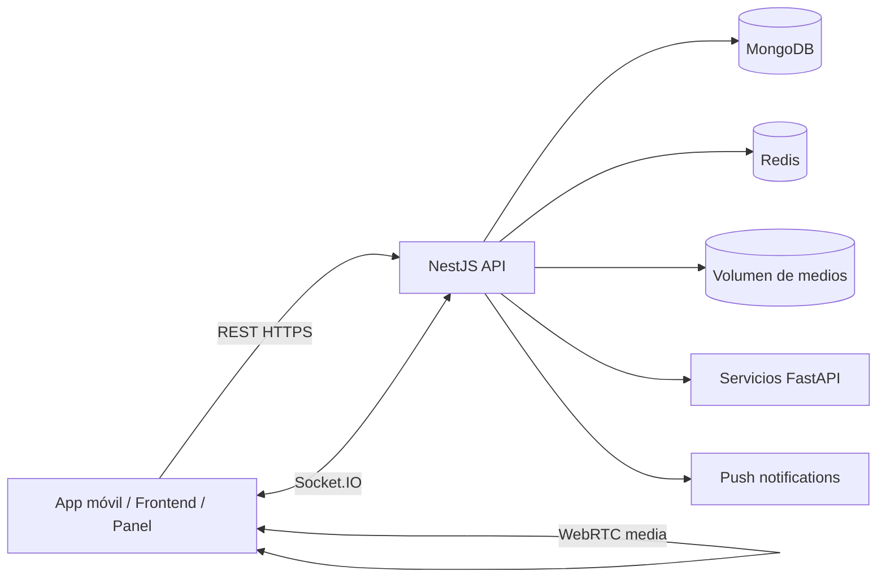

# Kids4Safe Backend

<p align="center">
  
</p>

API central de Kids4Safe. Gestiona autenticación, cuentas y perfiles, sesiones de Auxilio, políticas de permisos, notificaciones, ubicación, auditoría y almacenamiento de medios. También coordina las aplicaciones web/móvil y los servicios internos.

[](https://nestjs.com/) [](https://www.typescriptlang.org/) [](https://www.mongodb.com/) [](https://socket.io/) [](LICENSE)

## Capacidades

- Autenticación JWT y autorización basada en roles/permisos.
- Sesiones móviles y QR/link con políticas configurables y permisos con vencimiento.
- Señalización Socket.IO para coordinación WebRTC.
- Ubicación, historial, geocercas y clasificación contextual de IP.
- Notificaciones web y móviles.
- Registros de auditoría, reportes PDF y gestión de medios.
- Integración opcional con microservicios FastAPI.

## Arquitectura



## Requisitos

Node.js admitido por `package.json`, Yarn 4 mediante Corepack, MongoDB y Redis. El puerto local predeterminado es 7000.

## Instalación y ejecución

```powershell
corepack yarn install --immutable
Copy-Item .env.example .env.local
corepack yarn start:dev
```

Configure MongoDB, Redis, JWT, credencial interna de servicio, orígenes permitidos y almacenamiento multimedia en el entorno de ejecución. El archivo `.env.example` lista las variables disponibles; utilice valores distintos por entorno y no los publique. En producción, configure un volumen persistente para los medios.

## API y autenticación

La especificación OpenAPI y Swagger están disponibles en `/api/docs` cuando se ejecuta el backend. Las rutas administrativas usan JWT y permisos; las integraciones internas requieren su credencial de servicio. Las solicitudes de medios/ubicación dependen además de los permisos otorgados por la persona usuaria y la política de sesión.

## Datos y demostración

MongoDB almacena información persistente; Redis mantiene estado temporal y coordinación. El backend puede manejar perfiles, información de dispositivos, ubicación, notificaciones y medios. Para la edición de demostración, use cuentas y datos ficticios, limite el acceso al panel y elimine los registros de demostración al terminar.

## Documentación

Consulte [guías del backend](docs/README.md), [OpenAPI global](../global-docs/api/backend-openapi.yaml) y [arquitectura de microservicios](../global-docs/arquitectura/microservicios.md).

**© 2026 deco31416 · MIT.**
