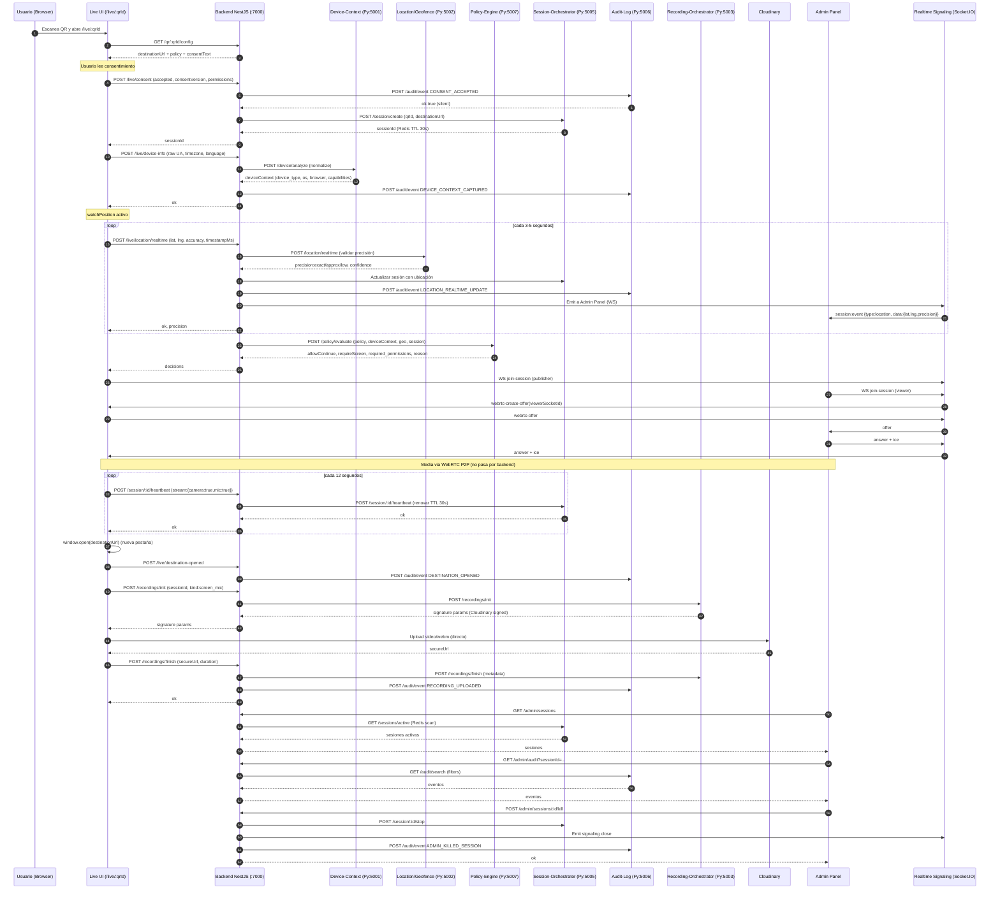

# Diagrama de Secuencia Kids4Safe v3.0 Enterprise

## Flujo completo: QR → Live → Ubicación tiempo real → Admin Panel

## Notas Clave

1. **Frontend NUNCA llama microservicios directamente** - Todo pasa por Backend NestJS
2. **Ubicación en tiempo real** - `watchPosition` actualiza cada 3-5s con throttle
3. **Clasificación de precisión**:
   - `exact` (≤20m): GPS móvil
   - `approx` (≤200m): WiFi
   - `low` (>200m): IP only
4. **WebRTC P2P** - Media no pasa por backend, solo signaling
5. **Heartbeat 12s** - Mantiene sesión viva (Redis TTL 30s)
6. **Audit Log** - Todos los eventos son silent (webhook, nunca falla)
7. **Admin Panel** - Recibe updates en tiempo real por WebSocket

## Event Types (Audit)

- `QR_SCANNED`
- `CONSENT_ACCEPTED`
- `DEVICE_CONTEXT_CAPTURED`
- `LOCATION_REALTIME_UPDATE`
- `PERMISSION_CAMERA_GRANTED`
- `PERMISSION_MIC_GRANTED`
- `PERMISSION_SCREEN_GRANTED`
- `PERMISSION_LOCATION_GRANTED`
- `DESTINATION_OPENED`
- `RECORDING_UPLOADED`
- `SESSION_DROPPED`
- `ADMIN_VIEWER_JOINED`
- `ADMIN_KILLED_SESSION`

## Ports Reference

| Service | Port | Type |
|---------|------|------|
| Backend NestJS | 7000 | HTTP + Socket.IO |
| Device Context | 5001 | HTTP (Python) |
| Location Geofence | 5002 | HTTP (Python) |
| Recording Orchestrator | 5003 | HTTP (Python) |
| Session Orchestrator | 5005 | HTTP (Python) |
| Audit Log | 5006 | HTTP (Python) |
| Policy Engine | 5007 | HTTP (Python) |
| Frontend | 3000 | Next.js |
| Admin Panel | 3002 | Next.js |
| Redis | 6379 | Database |
| MongoDB | 27017 | Database |
